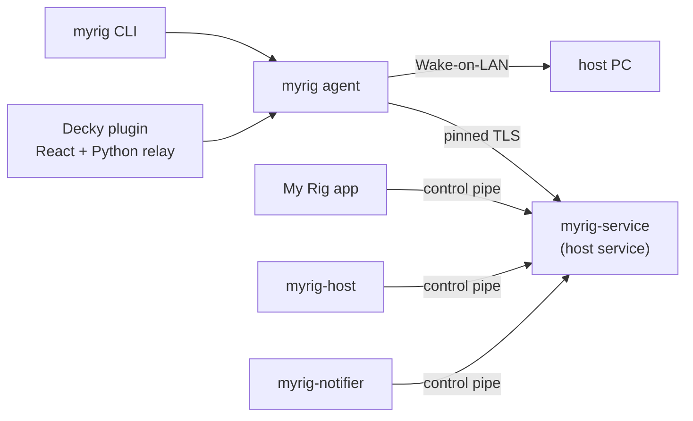

# Decky My Rig

Turn your Windows PC on and off from your Steam Deck, or from any Linux or
Windows machine with the `myrig` command.

The PC runs a small service. Your Deck talks to it over TLS, pinned to the
certificate it saw when you paired, and pairing takes the eight-digit code
the PC shows you.



## Install

Everything is on the [releases](../../releases) page.

### On the PC

Run `myrig-app-v<version>-<arch>-windows.exe`. It asks for admin rights once,
then installs the My Rig app, the background service, its firewall rule and
the notifier.

Reinstalling or upgrading keeps your paired devices. When you uninstall, you
choose whether to keep them.

### On the Steam Deck

Get `myrig-plugin-v<version>.zip`, then in Decky Loader open
**Settings → Developer**, pick **Install plugin from ZIP** and select the file.

### The command line

Get `myrig-cli-v<version>-<arch>-linux.tar.gz` or
`myrig-cli-v<version>-<arch>-windows.zip`, unpack it and put `myrig` (or
`myrig.exe`) somewhere on your `PATH`.

### Platforms

| Component | Architecture | OS |
| --- | --- | --- |
| Host app | `x86_64`, `aarch64` | `windows` |
| CLI | `x86_64`, `aarch64` | `linux`, `windows` |
| Decky plugin | `x86_64`, `aarch64` | `linux`, `windows` |

Decky Loader installs the same ZIP everywhere, so the plugin ZIP carries an
agent for each of these (`bin/myrig-<arch>-<os>`) and starts the one that
matches the device. On any other device the plugin can't run.

## Use

### From the Deck

Open **Quick Access → Decky My Rig**, go to **Settings → Add PC** and type the
eight-digit code your PC shows.

### With `myrig`

Pair with a PC:

```bash
myrig pair HOST [--port PORT]
```

Then:

| Command | What it does |
| --- | --- |
| `myrig list` | List saved PCs |
| `myrig status [NAME]` | Show whether a PC is on |
| `myrig wake NAME` | Wake a PC |
| `myrig stop NAME [--yes]` | Shut a PC down |
| `myrig rename NAME NEW_NAME` | Rename a saved PC |
| `myrig remove NAME [--yes]` | Forget a saved PC |

`NAME` is a saved PC's name or its ID.

Saved PCs live in `$XDG_CONFIG_HOME/decky-my-rig` on Linux (when
`XDG_CONFIG_HOME` is an absolute path, `~/.config/decky-my-rig` otherwise)
and in `%LOCALAPPDATA%\decky-my-rig` on Windows.

| Exit code | Meaning |
| --- | --- |
| `0` | Done |
| `1` | Refused or failed |
| `2` | Wrong usage |
| `3` | PC unreachable |

### On the PC with `myrig-host`

`myrig-host` is in the install folder.

| Command | What it does |
| --- | --- |
| `myrig-host status` | Show the service, its port and test mode |
| `myrig-host list` | List paired devices |
| `myrig-host pair NAME` | Open pairing for a device called NAME and print the code to type on it |
| `myrig-host remove ID` | Remove a paired device |
| `myrig-host rename ID NAME` | Rename a paired device |
| `myrig-host set-port PORT` | Move the service to another port (1024–65535) |
| `myrig-host test-mode on` | Turn test mode on |
| `myrig-host test-mode off` | Turn test mode off |

`ID` is the device's UUID from `myrig-host list`.

### Test mode

With test mode on, the PC accepts a Stop and reports it as a test, but stays
on. It's how you try Stop without losing your session:

```bash
myrig-host test-mode on
```

Turn it off for real shutdowns again:

```bash
myrig-host test-mode off
```

## Develop

### What you need

On any machine:

- Rust, at the version in `rust-toolchain.toml`
- Node.js 22.12 or newer, and pnpm 12
- Python 3.11 or newer

For the device side, also:

- a C compiler, and `clang` for aarch64 builds
- `cargo-deny`, `cargo-machete` and `betterleaks`
- for fuzzing only: `cargo-fuzz` and the nightly named in
  `fuzz/rust-toolchain.toml`

For the Windows host: the .NET 10 SDK and the MSVC build tools.

You don't need to memorise this: every script below checks for what's
missing and tells you how to install it.

### Setup

```bash
# The pinned Rust toolchain, with its components and targets
rustup toolchain install

# Every crate, including the Windows-only ones the checks read offline
cargo fetch --locked

# The plugin's packages (pnpm itself: npm install --global pnpm@12.2.1)
pnpm install --frozen-lockfile

# Ruff and Mypy, into out/quality-venv
bash tools/bootstrap_quality.sh
```

### Check and build

| Command | What it does |
| --- | --- |
| `bash tools/check_linux.sh` | All device-side checks; CI runs this too |
| `bash tools/check.sh` | Device and host checks (from WSL on the PC) |
| `bash tools/build_linux.sh` | The Linux CLI archives, into `out/release` |
| `bash tools/build_plugin.sh [--prebuilt-linux] [--windows x86_64,aarch64]` | The plugin ZIP, into `out/release`. `--windows` adds the Windows agents `build_windows.ps1` already built; `--prebuilt-linux` packs the Linux agents already in `out/cargo` |
| `bash tools/fuzz.sh [SECONDS]` | Each fuzz target in `fuzz/` for SECONDS (60 by default); failing inputs go to `out/fuzz/artifacts` |
| `bash tools/build.sh` | Every release file for this PC's architecture, the installer included (from WSL on the PC). Its plugin ZIP only has the x86_64 Windows agent; CI adds aarch64 |

To run one part at a time:

```bash
# Rust
cargo test --workspace --all-features --locked
cargo clippy --workspace --all-features --all-targets --locked -- -D warnings
# Line coverage (needs cargo-llvm-cov and `rustup component add llvm-tools`)
cargo llvm-cov --workspace --all-features --locked --summary-only

# The plugin ZIP, with the Linux agents only
cargo xtask plugin
# The frontend
pnpm test
pnpm run build
pnpm run lint

# The plugin's Python, and the integration tests
PYTHONPATH=py_modules MYRIG_BINARY=out/cargo/debug/myrig \
    python3 -m unittest discover -s tests/plugin -q
python3 -m unittest discover -s tests/integration -q
```

On Windows, in PowerShell:

```powershell
# Rust, C# and installer checks
.\tools\windows\check_windows.ps1

# The Windows release files (installer, CLI archives). aarch64 needs the
# MSVC ARM64 tools and clang, so a local build is usually x86_64 only.
.\tools\windows\build_windows.ps1 [-Architectures x86_64,aarch64]

# Just the installer
.\packaging\windows\build_installer.ps1 [-Arch aarch64]

# Install, upgrade and uninstall the installer on this PC. It changes services,
# the firewall and ProgramData, so it needs -Confirm, a signed-in user, and no
# My Rig already installed. Not part of the checks above.
.\tests\installer\end_to_end.ps1 -Installer .\out\release\<installer>.exe -Confirm
```

### Rules

- Everything generated goes in `out/`, Cargo's output in `out/cargo/`.
- Inline comments start with a marker for the editor's highlighter: `!` for a
  warning (something that breaks if changed carelessly, `SAFETY:` comments
  included), `*` for an important fact, `?` for the reason behind code that
  looks odd, `-` for anything else. Doc comments take none.
- OS-specific code (`cfg(...)`, `target_os`) belongs in the platform crates
  only (`crates/host-windows`, `crates/client-linux`, `crates/client-windows`)
  and in `main.rs` files.
- `VERSION` holds the version, and the plugin's `package.json` must match it.
- `fuzz/Cargo.lock` follows `Cargo.lock` (`tools/check_linux.sh` checks it).
  After you change `Cargo.lock`, run
  `cp Cargo.lock fuzz/ && (cd fuzz && cargo metadata --format-version 1 >/dev/null)`.
- When you update NuGet packages, commit the `packages.lock.json` changes too.
  C# tests that need a file from the app link it in `MyRigConfig.Tests.csproj`.
- A PC accepts up to 16 paired devices. `MAX_PAIRED_DEVICES` in
  `crates/host-core/src/paired_devices/consts.rs` and `MaxPairedDevices` in the
  Windows app's `LocalControlConstants.cs` change together.
- The characters a device name can't contain are listed twice: `INVISIBLE` in
  `crates/protocol/src/validation/consts.rs` and `InvisibleRanges` in
  `LocalControlConstants.cs`. Change both; both test suites read
  `tests/fixtures/local-control/names.json`.
- The installer's ACLs use SID strings, never account names, which Windows
  translates.
- A change to `tests/fixtures/` goes in the same commit as the Rust and C#
  changes that need it. `invalid-*` fixtures must stay rejected, and
  `tests/integration/` never imports production code.

## Release

Push a version tag from a commit on `main`:

```bash
git tag "v$(cat VERSION)"
git push origin "v$(cat VERSION)"
```

`release.yml` checks that the tag matches `VERSION` and that the commit is on
`main`, runs CI again, then publishes the files. The release notes list their
SHA-256 checksums, and each file has a build attestation you can check with
`gh attestation verify <file> -R <owner>/<repo>`.

## License

MIT, see [LICENSE](LICENSE). The plugin ZIP includes the notices of the
libraries it bundles, in `bin/` and `dist/THIRD-PARTY-NOTICES.txt`.
